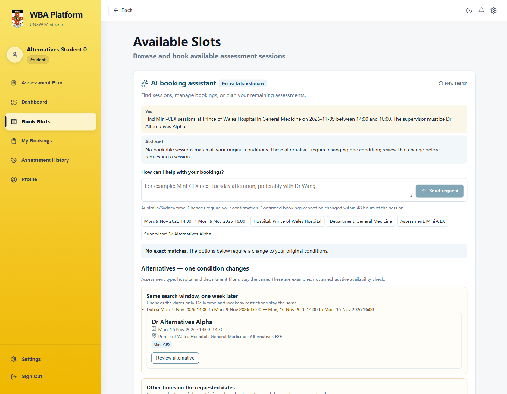
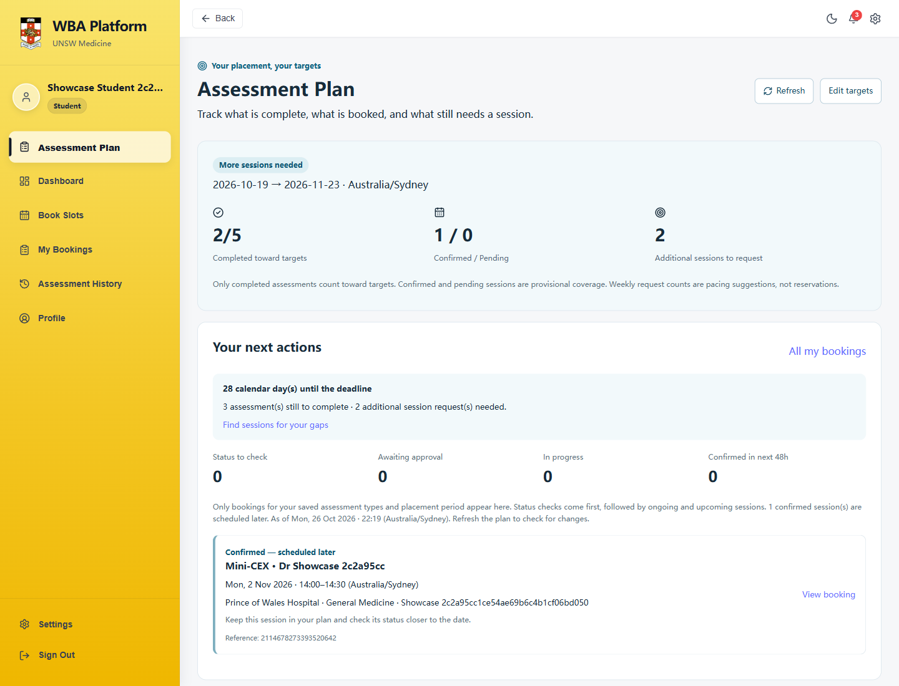
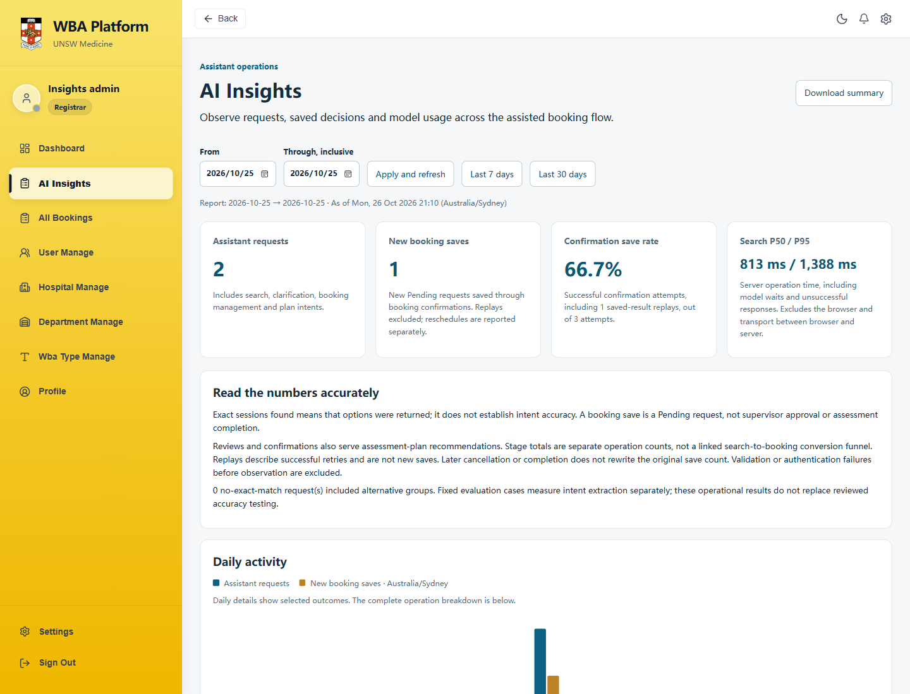

# WBA Connect · 临床评估预约与 AI 助手

面向医学生、评估导师和管理员的临床评估预约平台，支持找场次、提交预约、导师审批和评估进度跟踪。

我在课程团队项目的基础上，借助 AI 工具迭代了自然语言预约助手、个人评估规划和运行看板。模型理解需求，服务端查询真实场次；预约、取消和改期均需用户核对确认。

[应用截图](#应用截图) · [快速开始](#快速开始) · [产品文档](#产品文档)

## 主要功能

| 场景 | 可以做什么 |
| --- | --- |
| AI 找场次 | 按时间、类型、医院、科室和导师偏好查询，无完全匹配时展示明确的替代条件 |
| 预约管理 | 查看本人预约，预览并确认新预约、取消或改期，保留历史与重试回执 |
| 个人评估规划 | 设置个人目标，区分已完成、已确认和待审批，查看缺口与下一步操作 |
| 导师工作台 | 发布评估时段，审批请求，记录已结束场次的评估结果 |
| 运行看板 | 管理员查看请求结果、保存与重试、响应耗时和模型 Token 用量 |

## 应用截图

以下为本地真实应用截图，使用合成演示账号和场次；看板展示验收过程中的运行记录。

### AI 查询与替代建议

自然语言需求转为真实场次查询；没有完全匹配时，标明需要改变的条件，由用户选择并确认。



### 个人评估规划与跟进

集中查看完成进度、预约覆盖和待办，已确认的未来场次仍需完成后才计入进度。



### AI 运行看板

查看请求结果、首次保存与重试、P50/P95 耗时和已报告的 Token，用于核对实际运行情况。



## 快速开始

需要 Docker Desktop、Java 25+、Maven、Node.js 和 Python 3.10+。

1. 首次使用时将 `.env.example` 复制为 `.env`；已有配置时保留原文件。在其中设置 `BOOKING_AI_ENABLED=true`，填写自己的 `BOOKING_AI_API_KEY`。
2. 安装前端依赖并启动隔离演示环境：

```powershell
cd unsw-comp9900-WBA-frontend
npm install
cd ..
python scripts/local_demo.py start
python scripts/demo_showcase.py setup
```

打开 [本地应用](http://127.0.0.1:5178)。以下均为公开的本地演示账号，密码统一为 `WbaDemo!2026`：

| 角色 | 邮箱 | 体验入口 |
| --- | --- | --- |
| 学生 | showcase-student@wba.test | Book Slots、Assessment Plan |
| 导师 | showcase-mentor@wba.test | Upcoming Sessions |
| 管理员 | showcase-admin@wba.test | AI Insights |

学生在 **Book Slots** 输入评估类型、时间和导师偏好，选择场次后核对并确认。提交结果为 Pending，等待导师审批；确认后的预约距开始不足 48 小时不能取消或改期。

查看状态：`python scripts/local_demo.py status`；停止：`python scripts/local_demo.py stop`。专用演示数据的重置与五分钟操作流程见[演示指南](docs/demo/SHOWCASE.md)。

## 技术栈

| 部分 | 技术 |
| --- | --- |
| 前端 | React、Vite |
| 后端 | Java、Spring Boot |
| 数据与缓存 | MySQL、Redis |
| 模型 | DeepSeek，结构化意图解析 |
| 本地运行 | Docker Compose、Python 启动脚本 |

## 产品文档

- [产品案例与方案取舍](docs/portfolio/AI_BOOKING_CASE_STUDY.md)
- [评测结果与适用范围](docs/evaluation/ASSESSMENT_PLAN.md)
- [完整运行说明与迭代记录](docs/PROJECT_GUIDE.md)，包含原 Docker 部署方式与各轮验收
