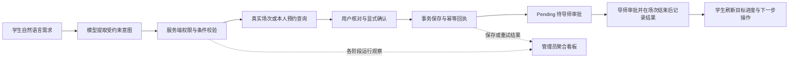

# WBA AI 预约与评估规划助手

作品集案例稿 · 本地可运行原型。技术方案与产品取舍已落地，真实用户价值仍待研究验证。

## 一句话介绍

在已有临床评估预约平台上，增加自然语言找场次、确认预约、取消与改期、个人评估规划和运行观测，串联学生提出需求、导师审批、人工完成评估、学生查看进度的流程。

**项目归属：** 原始 WBA 系统是课程团队项目，前后端框架、角色、基础预约和管理页面来自团队基线。这里展示的是基于该基线、借助 AI 编程工具实现并验证的增量产品迭代。对外展示时应据实补充自己的团队角色和实际承担工作，不应把整个原系统都描述为个人独立开发。

用户已确认在原团队项目中参与需求分析、原型设计、前端、测试与项目协调。对照原 Proposal 后，补充了团队客户范围确认、用户故事、原型与验收证据；不推定本人担任 Product Owner 或 Scrum Master。

原 Proposal 的客户范围邮件将 AI 列为首版之外的扩展，因此原课程 MVP 与后来的个人 AI 迭代分阶段表达，尚无客户对本轮 AI 功能验收的记录。

## 问题与假设

原 Proposal 描述了学生找评估导师、导师发布供给和管理员掌握整体进度的问题，并附有客户对 MVP 范围的回复。源码与流程梳理进一步显示，预约需要同时处理时间、医院、科室、评估类型和导师偏好；学生还需要在预约与评估记录之间判断后续缺口。客户范围确认支持业务背景与计划边界，尚不能替代目标用户访谈或证明 AI 入口有收益。

待验证的产品假设：条件较多时，自然语言入口可以减少筛选操作；把个人目标、真实状态与下一步操作放在同一页面，可能降低跟进成本。验证需要让目标用户完成同等任务，比较原入口与 AI 入口，而不是用 Demo 成功替代结论。

主要用户为安排评估的学生；导师负责审批和评估结果；管理员需要了解运行结果与失败。系统不生成临床结论、诊断、评分或官方课程达标判断。

## 产品范围与关键取舍

| 决策 | 落地方式 | 原因与代价 |
| --- | --- | --- |
| 使用受约束的 Agent 工作流 | 一次模型调用提取结构化意图；受控服务查询、预览、确认；服务端独立处理状态与规则 | 便于验证和恢复；复杂多步需求需要澄清或用户分步选择，不宣称无限自主规划 |
| 把模型理解和业务事实分开 | 模型输出筛选意图，真实库返回场次；评分、个人目标和数据库编号不交给模型决定 | 减少编造候选和错误执行；查询、权限、冲突与事务仍需业务开发 |
| 写操作先核对再确认 | 预览包含真实导师和日期；显式勾选后提交；短期草稿与所有权校验 | 多一次确认操作，但能避免歧义直接产生预约；提交只是 Pending，审批仍由导师完成 |
| 改期作为一个业务事务 | 原预约取消与新预约 Pending 原子保存；失败保留原预约；同一确认重试返回已有回执 | 避免用户失去原预约、丢响应后重复创建，增加锁、版本及幂等处理复杂度 |
| 无结果时显式放宽一项条件 | 日期、时间、导师或星期单项替代，保留类型、医院和科室；用户接受后确认 | 提高可理解性；仍可能没有候选，不保证每次都能预约 |
| 个人目标与课程要求分开 | 学生设置目标；Completed、Confirmed、Pending、进行中分别计算；只有真实完成计入完成数 | 可以独立使用规划功能，但不能自动证明课程达标或推断缺勤 |
| 先观测可核对的运行事实 | 分阶段操作数、首次保存/重放/失败、P50/P95、已报告 Token 和用量覆盖 | 能追踪稳定性；没有会话关联漏斗，不能把阶段计数直接当搜索转化率 |

## 已实现的流程

前端 React/Vite，后端 Java/Spring Boot，MySQL 保存预约、目标及观察，Redis 缓存待确认草稿。业务时间使用 Australia/Sydney，浏览器其他时区不会改写预约墙上时间。默认演示禁用外部邮件和 Google Calendar 凭据。

规划页面和常规预约可以独立于模型使用。模型不可用时，AI 入口明确返回不可用状态；无候选和需要澄清也分别展示，不以编造结果补齐。
