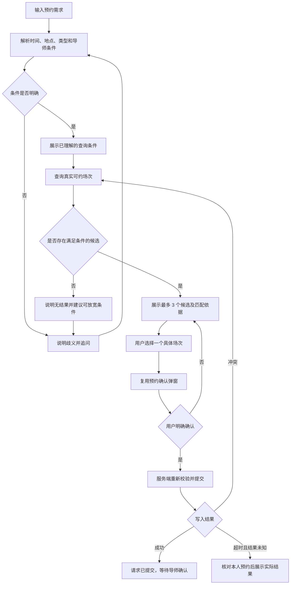

# AI 预约助手：现状与首版方案

现状检查基于 `v0.1.0-wba-baseline`（`005be9c`）的源码。

本阶段完成页面、接口、权限及预约规则的静态梳理。下文明确区分已有能力和待实现方案；尚未进行用户访谈、真实模型调用、应用启动或端到端业务验证。

## 1. 首版产品定位

在学生现有的 Book Slots 页面增加自然语言预约入口，帮助用户把时间、医院、科室、评估类型和导师偏好转为查询条件，再从真实可约场次中选出候选。用户核对并确认后，提交预约请求，继续沿用原有导师审批流程。

产品假设：当预约条件较多时，自然语言输入可以减少筛选和核对操作。这项假设需要用同组任务比较原页面与 AI 入口的完成时间、成功率和用户偏好，不能仅凭 Demo 判断成立。

首版任务示例：

> 帮我找下周二下午的 Mini-CEX，优先王老师。如果没有，请列出需要放宽哪些条件。

当前系统界面以英文为主。首版入口沿用页面语言，需求解析计划覆盖中文和英文；具体措辞、导师名和业务字典均以本系统的数据为准。

## 2. 原系统的实际流程

学生创建预约后，状态由插入填充逻辑设为 `0 / Pending`。导师批准后才进入 `1 / Confirmed`。助手必须说“预约请求已提交，等待导师确认”，不能把提交成功表述为导师已确认。

相关代码：

- [学生预约页面](../../unsw-comp9900-WBA-frontend/src/pages/Main/Home/Student/BookSlot/index.jsx)：筛选、场次选择、确认弹窗、提交和通知。
- [我的预约页面](../../unsw-comp9900-WBA-frontend/src/pages/Main/Home/Student/MyBooking/index.jsx)：状态展示、取消、日历入口。
- [导师时段服务](../../unsw-WBA-backend/unsw-WBA-service/src/main/java/edu/unsw/service/impl/AssessmentSlotServiceImpl.java)：重复场次计算和审批。
- [自动填充逻辑](../../unsw-WBA-backend/unsw-WBA-core/src/main/java/edu/unsw/core/config/mybatisplus/MyMetaObjectHandler.java)：当前用户、初始状态和版本号。

## 3. 可复用的接口

下表为后端路由，浏览器通过 `/api` 代理前缀访问。

| 能力 | 方法及路由 | 已有行为 | 首版使用方式 |
| --- | --- | --- | --- |
| 查询可约时段 | `GET /student/assessmentBooking/getAvailableAssessmentSlotList` | 医院、科室、类型、分页、按最近可用时间排序 | 作为真实候选的数据来源，先补齐日期和导师筛选 |
| 创建预约 | `POST /student/assessmentBooking/bookings` | 接收时段 ID、开始结束时间、版本；生成待审批请求 | 用户确认后复用原业务服务，先补齐提交校验 |
| 我的预约 | `GET /student/assessmentBooking/bookings/my` | 当前登录用户的预约分页 | 查询个人预约、核对重复提交和时间冲突 |
| 取消预约 | `POST /student/assessmentBooking/cancelBooking?id=...` | 校验本人归属；已确认且距开始不足 48 小时不能取消 | 保留原页面入口，首版助手不自动取消 |
| 启用的医院 | `GET /general/dictionaryManage/getEnabledHospitals` | 返回业务字典 | 解析和核对医院名称 |
| 启用的科室 | `GET /general/dictionaryManage/getEnabledDepartments` | 返回业务字典 | 解析和核对科室名称 |
| 启用的评估类型 | `GET /general/dictionaryManage/getEnabledWbaTypes` | 返回业务字典 | 解析和核对评估类型 |
| 导师审批 | `POST /supervisor/assessmentSlot/approveSlot` 等 | 导师已有审批页面和状态流转 | 沿用现有流程，助手不代导师审批 |

接口来源：[学生 Controller](../../unsw-WBA-backend/unsw-WBA-api/src/main/java/edu/unsw/api/controller/student/StudentBookingController.java)、[字典 Controller](../../unsw-WBA-backend/unsw-WBA-api/src/main/java/edu/unsw/api/controller/general/DictionaryController.java)、[导师 Controller](../../unsw-WBA-backend/unsw-WBA-api/src/main/java/edu/unsw/api/controller/supervisor/AssessmentSlotController.java)。

目前没有独立的学生“改期”接口。改期涉及新旧预约的协调和失败恢复，不应在首版中用“先取消旧预约，再尝试新预约”拼接代替。

### 查询与创建的数据约束

- 查询对象：[AssessmentSlotQueryDto](../../unsw-WBA-backend/unsw-WBA-domain/src/main/java/edu/unsw/domain/dto/AssessmentSlotQueryDto.java) 及其父类 [BaseQueryDto](../../unsw-WBA-backend/unsw-WBA-domain/src/main/java/edu/unsw/domain/dto/BaseQueryDto.java)。
- 场次结果：[AssessmentSlotVo](../../unsw-WBA-backend/unsw-WBA-domain/src/main/java/edu/unsw/domain/vo/AssessmentSlotVo.java)，包含 `id`、`creator`、`creatorName`、`availableTimeList`、`version` 等。
- 创建参数：[AssessmentBookingSaveDto](../../unsw-WBA-backend/unsw-WBA-domain/src/main/java/edu/unsw/domain/dto/AssessmentBookingSaveDto.java)，实际字段为 `assessmentSlotId`、`startTime`、`endTime`、`slotVersion`。
- 现有页面额外发送的 `type` 不在创建 DTO 中，助手不能将它当作已支持的写入参数。
- 时段和预约采用 Long ID；前端和模型交互中按字符串保留，避免雪花 ID 经过 JavaScript Number 后丢失精度。
- 重复时段必须选择 `availableTimeList` 中的具体起止时间，不能只用模板日期或把两次场次的起止时间拼在一起。

## 4. 权限与业务边界

前端 [routeMap.jsx](../../unsw-comp9900-WBA-frontend/src/config/router/routeMap.jsx) 已区分学生、导师、管理员及超级管理员。首版入口放在学生 `/home/student/bookSlot` 页内，位于现有筛选栏上方，继续保留原筛选和预约操作。

后端已有登录拦截器、路径与角色匹配、角色继承和当前用户上下文。助手接口拟使用 `/student/bookingAssistant/**`，接入原认证链路，并明确以当前登录学生为操作主体。不能让模型传入或覆盖预约创建人，也不能仅靠前端隐藏入口判断权限。由于现有角色存在继承关系，实现时需明确上级角色是否允许使用此入口。

相关代码：[WebConfigurer](../../unsw-WBA-backend/unsw-WBA-core/src/main/java/edu/unsw/core/config/WebConfigurer.java)、[PermissionInterceptor](../../unsw-WBA-backend/unsw-WBA-core/src/main/java/edu/unsw/core/interceptor/PermissionInterceptor.java)、[RolePermissionUtils](../../unsw-WBA-backend/unsw-WBA-core/src/main/java/edu/unsw/core/utils/RolePermissionUtils.java)。

## 5. 接入前需要补齐的能力

这些结论来自源码检查，尚未在运行环境中复现。只列与助手查询和预约直接相关的内容。

| 问题 | 源码依据 | 对助手的影响 | 后续处理 |
| --- | --- | --- | --- |
| 学生查询没有完整应用日期与导师参数 | 查询 DTO 有字段；学生查询仅增加状态、启用、结束时间条件；公共查询函数主要按医院、科室和类型过滤 | “下周二”“指定导师”不能直接可靠映射为现有查询 | 在学生查询链路显式支持导师和日期，按具体 occurrence 过滤并验证分页 |
| 重复场次的查询边界需调整 | 学生查询使用模板 `endTime >= now`；重复场次由另一段逻辑展开 | 首次发生时间已过去但后续仍有效的重复时段可能被排除 | 按有效重复范围与未来 occurrence 判断，不直接套用单次时段规则 |
| 创建预约缺少完整的时间和启用校验 | 创建服务检查存在、状态、版本和同场次占用，未见启用状态、请求时间属于真实场次、当前学生跨时段重叠的完整检查 | 错误参数可能绕过页面选择约束 | 在业务服务统一校验，助手和普通页面共享规则 |
| 并发保护需要覆盖实际写入结果 | 已有时段锁、版本检查、同场次待确认/已确认占用检查；锁在方法 finally 中释放 | 不能据此认定所有并发和事务边界已验证 | 覆盖两个用户竞争同场次、同学生并发预约不同重叠时段，并核对最终数据库结果 |
| 业务时区不一致的可能性 | 日历使用 `Australia/Sydney`，业务计算多处使用 JVM 默认时区，配置还出现 `GMT+10` | “明天下午”和取消时限可能出现偏差 | 首版暂按学校场景选 `Australia/Sydney`，统一解析、比较和展示；验证夏令时及跨时区访问 |
| 通知失败可能被展示成预约失败 | 页面在同一 try 中先创建预约，再 await 通知请求 | 实际已提交时，用户可能误以为失败并重复提交 | 以创建接口结果判定预约；通知单独处理，失败时不重复创建 |
| 请求限流不等于业务幂等 | 拦截器按注解限流，学生创建接口没有该注解，也没有已实现的请求键回放 | 超时或连续点击后的结果不明确 | 增加提交幂等设计；结果不确定时先核对本人预约，禁止盲目重试写操作 |

主要依据：[StudentBookingServiceImpl](../../unsw-WBA-backend/unsw-WBA-service/src/main/java/edu/unsw/service/impl/StudentBookingServiceImpl.java)、[AssessmentSlotServiceImpl](../../unsw-WBA-backend/unsw-WBA-service/src/main/java/edu/unsw/service/impl/AssessmentSlotServiceImpl.java)、[RepeatRequestInterceptor](../../unsw-WBA-backend/unsw-WBA-core/src/main/java/edu/unsw/core/interceptor/RepeatRequestInterceptor.java)。

## 6. 首版交互

### 页面状态

| 状态 | 展示与交互 |
| --- | --- |
| 初始 | 输入框、示例需求，原筛选表单仍可使用 |
| 解析或查询中 | 明确显示正在处理；避免重复提交，允许放弃查询 |
| 需要澄清 | 显示具体缺失或歧义条件，保留已确认的条件 |
| 有候选 | 卡片显示导师、具体日期与时间、业务时区、医院、科室、类型、地点及匹配依据 |
| 无结果 | 说明原条件未匹配；替代建议标出需要放宽的条件，由用户决定 |
| 待提交确认 | 展示完整场次详情；此时数据库尚未新增预约 |
| 提交成功 | 展示真实预约 ID 和 Pending 状态，提供我的预约入口 |
| 失败或结果未知 | 区分明确失败、资源冲突和结果待核对，禁止把未知结果当作成功或自动重试 |
| 模型不可用 | 显示可理解的错误并保留原筛选表单，不生成虚构候选 |

“优先某导师”属于偏好；“必须某导师”属于硬条件。找不到硬条件结果时不静默放宽。候选不足三个时只展示实际数量。

## 7. 模型和工具的分工（待实现）

采用固定工作流：模型解析需求，代码验证结构并执行限定查询，结果来自业务接口，用户确认后执行预约。首版不需要多智能体或知识库检索。

| 环节 | 负责方 | 约束 |
| --- | --- | --- |
| 自然语言转结构化需求 | 模型 | 明确参考时间与业务时区；无法判断时追问，不创造业务 ID |
| 业务名称匹配与参数验证 | 服务端 | 根据真实字典和导师数据核对，拒绝未知字段及无效时间范围 |
| 真实场次查询与排序 | 服务端工具 | 处理分页、重复场次和用户预约冲突；搜索范围及结果上限有界 |
| 候选说明 | 页面或模型 | 只解释真实候选和已验证条件；不得编造导师、地点或可用时间 |
| 确认并提交 | 页面及业务服务 | 模型无直接写入权；当前学生、时段、时间、版本由服务端核验 |

拟提供只读接口 `POST /student/bookingAssistant/search`，返回结构化条件、澄清问题或真实候选及 trace ID。接口名称和 DTO 在实现时确认，当前尚未新增该路由。

模型供应商、模型名、服务地址和调用密钥通过服务端环境变量配置，不放进前端或 Git。尚未选定供应商，也未进行模型效果及成本比较。请求日志沿用现有追踪能力，并记录解析版本、工具结果、耗时和失败类别；不把完整用户档案或日历凭据发送给模型。

## 8. 按轮次实施

| 轮次 | 交付物 | 完成判据 |
| --- | --- | --- |
| 第 1 轮：现状与范围（本次） | 页面/接口梳理、首版流程、能力缺口、验收场景 | 源码可追溯；已有和计划能力分开记录 |
| 第 2 轮：查询基础 | 日期及导师筛选、重复场次过滤、时区约定、脱敏查询样例 | 单次和重复时段在指定窗口内正确返回，分页不漏掉满足条件的场次 |
| 第 3 轮：只读 AI 查询 | 输入入口、服务端模型调用、结构校验、澄清、候选卡片 | 中文和英文需求可查询真实数据；无密钥或调用失败时可继续用原表单 |
| 第 4 轮：确认预约 | 提交校验、冲突处理、幂等、真实 Pending 回执、通知分离 | 明确确认前不写入；重复或并发提交不会产生错误预约 |
| 第 5 轮：验证与复盘 | 真实模型评测、表单对照、失败分析、成本与延迟记录 | 结果可复现；区分人工评审、自动检查和真实用户反馈 |

首版助手暂不执行改期、取消、导师审批、后台数据维护或批量预约。这些动作可以继续通过原系统完成。

## 9. 首批验收场景

这些是待执行场景，不是已通过的测试或真实用户反馈。模型解析场景需固定参考时间和业务时区，场次来自脱敏测试数据；写入场景使用独立测试数据。

| ID | 场景 | 预期 |
| --- | --- | --- |
| Q01 | 明确日期、下午、评估类型 | 只返回满足硬条件的真实场次 |
| Q02 | 用英文输入等价需求 | 与同条件中文输入得到一致约束 |
| Q03 | 两位导师同名或名称有歧义 | 追问，不随意选择某个 ID |
| Q04 | 指定医院的常见简称 | 仅在真实字典中匹配，歧义时澄清 |
| Q05 | “优先王老师，但其他老师也可以” | 区分偏好和硬条件，说明实际导师 |
| Q06 | “必须王老师”，该导师无空位 | 不自动替换导师 |
| Q07 | 查询下周的重复场次，首次发生已在过去 | 返回窗口内尚未占用的真实 occurrence |
| Q08 | 查询窗口前几页都没有匹配场次 | 不把未搜索完误报为无结果 |
| Q09 | 同一时段的某个重复场次已被占用 | 排除该场次，保留其余有效场次 |
| Q10 | 过去日期、开始时间不早于结束时间 | 不提交无效查询或预约 |
| Q11 | 学生已有重叠的 Pending 或 Confirmed 预约 | 不推荐可直接提交的冲突选项 |
| Q12 | 从中国时区访问悉尼业务时段 | 查询、候选和提交时间保持一致，展示业务时区 |
| Q13 | 夏令时切换附近的相对日期 | 使用地区时区规则，不固定加十小时 |
| Q14 | 无任何满足条件的结果 | 说明无结果和可放宽条件，不编造三个候选 |
| Q15 | 模型输出无法解析、未知业务名、伪造 ID | 校验失败并澄清或报错，不直接查询或写入 |
| Q16 | 模型超时、缺少密钥或供应商不可用 | 展示错误，原表单可继续使用 |
| W01 | 选择候选但未点击确认 | 预约数据不变化 |
| W02 | 确认前该场次被其他学生占用 | 服务端拒绝并刷新候选，不显示成功 |
| W03 | 确认前导师停用或修改时段 | 重新校验并拒绝旧候选 |
| W04 | 篡改时间，时间不属于该时段的真实 occurrence | 后端拒绝 |
| W05 | 连续点击确认，或网络超时后重试 | 一次请求语义对应一个可核对结果，避免重复创建 |
| W06 | 同学生并发预约两个重叠场次 | 最终写入结果符合冲突约束 |
| W07 | 预约创建成功，通知发送失败 | 保留真实成功结果，单独提示通知状态 |
| W08 | 非学生、过期登录或要求替其他人预约 | 按明确权限规则拒绝，操作主体不能由模型覆盖 |
| W09 | 成功创建预约 | 回执为 Pending，展示真实预约 ID；不声称导师已批准 |
| W10 | 用户要求直接改期、自动取消或代导师批准 | 解释当前入口范围，导向原页面或明确未支持 |

## 10. 效果记录口径

首轮先记录基线，再设置优化目标。当前没有已测得的提升比例。

- 条件理解正确率：人工核对模型抽取的硬条件、偏好、时间和业务实体。
- 候选有效率：候选满足已确认条件，且对应真实未来可约场次。
- 任务完成率：从输入到正确提交 Pending 请求的任务占比；导师后续批准不算助手已完成的结果。
- 错误写入：未确认创建、错人错时段、重复或重叠预约，单独作为阻断问题处理。
- 完成耗时：对同组任务比较原筛选表单与助手入口，同时记录澄清次数和人工回退。
- 运行代价：记录真实调用次数、Token 用量、单次任务成本和延迟分布，不用 Prompt 长度估算代替真实账单。

## 11. 与现有 Docker 的衔接

检查时，已有 WBA 容器属于 D 盘原目录的 Compose 项目，前后端使用构建镜像，未挂载业务源码。E 盘工作副本的源码修改不会自动出现在这些镜像里。

现有 MySQL、Redis、上传文件卷属于原 Compose 项目。后续验证时应先明确使用已有数据还是独立演示数据，再配置项目名称、数据卷、网络和凭据。不能直接在 E 盘执行一次全量 `compose up` 就假定会复用旧数据：两个目录的默认项目名不同，且原配置使用了固定容器名。

本阶段无需重建容器。实现完成后再更新对应前后端镜像；涉及已有数据时先备份，并检查模型和通知行为。真实业务数据不作为模型评测语料。
