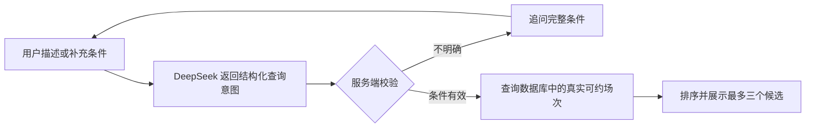

# 第 3 轮：只读 AI 预约查询（本地开发）

本轮按用户要求只在本地修改，未推送 GitHub，未更新原有 Docker 部署。

后续已进一步完成页面、真实模型与独立 MySQL/Redis 的联调，后续结果见[第 4 轮记录](ITERATION_04_LOCAL_DEMO.md)。本页保留第 3 轮完成时的验证范围。

## 已实现

Book Slots 页面新增 AI 查询区域：输入自然语言需求、补充澄清信息、查看结构化条件和最多三个候选。现有表单和预约流程继续可用。AI 查询入口不创建预约、取消预约、改期、发通知或替导师审批。

后端通过 DeepSeek JSON 输出解析查询条件，服务端再检查字段、业务字典、导师名称、日期及时间范围，调用现有时段查询服务。候选中的导师、地点、时段和 ID 均取自数据库查询结果，不接受模型生成的候选或业务 ID。

新增每日起止时间与星期限制，用于“下周每天下午”“下周二和周四 14 点后”等条件。它们在实际场次展开后、分页前过滤，不能只按一整周的连续时间范围替代下午限制。



## 接口与行为

`POST /student/bookingAssistant/search`

```json
{
  "message": "内科",
  "history": ["帮我找下周二下午的 Mini-CEX"]
}
```

当前消息最长 1500 字符，最多携带六条先前用户需求。页面保留本次搜索的上下文，六次有效请求后提示开启新搜索；刷新页面或点击 New search 清空页面会话，不持久化聊天记录。

返回状态：

| 状态 | 含义 |
| --- | --- |
| `READY` | 找到真实候选；尚未创建预约 |
| `CLARIFY` | 需要补充条件、明确业务名称或消除导师歧义 |
| `NO_RESULTS` | 查询成功，但没有满足条件的场次 |
| `UNAVAILABLE` | 未配置模型、模型调用失败、返回格式不合法或查询异常；保留普通筛选入口 |
| `UNSUPPORTED` | 当前入口不执行用户要求的写操作 |

返回中包含业务时区、确认后的查询条件、候选和 trace ID。页面展示用户需要核对的条件，不展示调用密钥、模型原始响应或内部错误信息。

“必须某导师”作为硬条件；“优先某导师”作为偏好排序，其他条件仍保留。偏好排序覆盖完整的已过滤结果，不会因为导师排在普通查询第一页之后就忽略它。同名或无法唯一匹配的导师会要求澄清，不任意选一个 ID。当前导师匹配沿用项目中导师角色 ID 为 3 的约定；别名和跨语言姓名映射尚未实现。

## DeepSeek 本地配置

代码与 `.env.example` 默认关闭真实模型调用，示例不包含可用密钥。本机已将用户填写的密钥迁移到 Git 忽略的根目录 `.env`，并开启其中的 AI 开关。其他环境若尚无 `.env`，可从 `.env.example` 创建；若已有 `.env`，仅追加或更新以下字段，保留现有数据库及其他配置：

```dotenv
BOOKING_AI_ENABLED=true
BOOKING_AI_ENDPOINT=https://api.deepseek.com/chat/completions
BOOKING_AI_MODEL=deepseek-flash
BOOKING_AI_API_KEY=填写自己的DeepSeek密钥
BOOKING_AI_TIMEOUT_SECONDS=20
BOOKING_AI_DISABLE_THINKING=true
```

密钥只用于后端。`.env` 已被 Git 忽略，前端没有相应的 `VITE_` 密钥配置。IDE 运行后端时应在启动配置中设置这些环境变量，根目录 `.env` 不会被 Java 自动读取。

本轮已修改 E 盘工作副本的 Compose 环境变量传递配置，但未重建任何容器。D 盘原部署仍使用原镜像与目录，配置工作副本不等于更新原部署。

接入参考 DeepSeek 官方的 [JSON Output](https://api-docs.deepseek.com/guides/json_mode/) 和 [Chat Completions](https://api-docs.deepseek.com/api/create-chat-completion/) 文档。使用 JSON object 响应格式、明确 JSON 结构提示，并关闭 thinking；模型名称和完整接口地址均可配置。

## 验证结果

| 检查 | 结果 |
| --- | --- |
| 后端 Maven 六模块编译与测试 | 41 项测试通过，0 失败 |
| 前端测试 | 9 项通过，0 失败 |
| 前端生产构建 | 通过，保留已有的大包体积提示 |
| 新组件、工具、API 封装及修改的 Axios 文件 ESLint | 通过；Book Slots 页原有的 effect lint 问题继续记录于第 2 轮 |
| Compose 配置 | 使用 `.env.example` 静态校验通过，未启动部署 |
| 浏览器 | 模拟接口下桌面及手机交互通过，无页面异常、无预约或通知写请求 |
| 真实 DeepSeek 接口 | 使用实际 Java 解析适配器调用 3 次，3 个样本均符合预期；仅使用模拟需求，未访问数据库 |

后端新增验证包含：

- 本地 HTTP 模型接口协议：JSON mode、参考日期和业务时区、超时、空响应、截断、非法字段、伪造业务 ID 和候选拒绝、错误响应内容不外泄。
- 条件处理：未知字典、导师歧义、硬条件与偏好区分、偏好导师位于后续页面、候选去重、无结果、跟进需求上下文。
- 控制器：仅当前学生角色允许调用，空输入、超长输入及过长历史在调用模型前拒绝。
- 完整本地链路：模拟模型 HTTP 响应 → 服务端条件检查 → 真实 MyBatis 查询独立 H2 内存数据库 → 返回唯一正确候选；核对预约及场次行数未变化。

浏览器验证了澄清后继续输入、条件标签、候选展示、偏好标签、无结果、未支持请求、不可用降级、新搜索取消请求、忽略迟到结果、对话滚动到最新回复，以及 1440px / 390px 布局。

配置密钥后，使用编译后的 `JsonBookingIntentParser` 对真实 DeepSeek 接口进行了三次冒烟验证。为使日期结果可复核，三个样本都使用固定参考时间（具体值见评测配置），业务时区为 `Australia/Sydney`，字典及导师名称均为模拟数据：

| 样本 | 实际解析结果 | 适配器耗时 |
| --- | --- | --- |
| “帮我找下周二下午的 Mini-CEX” | 目标星期二，12:00–18:00，Mini-CEX | 2041 ms |
| 在上条基础上改成下周二、周四下午，优先 Dr Chen，其他导师也可以 | 保留 Mini-CEX 与下午限制，星期二、四，导师模式 `PREFERRED` | 748 ms |
| 要求直接预约并通知导师 | `UNSUPPORTED`，未执行预约或通知 | 579 ms |

前两个样本还校验了匹配场次的语义：接受目标日期下午的半小时场次，排除上午、不指定的星期和下一周场次；第二个样本同时接受星期四下午场次。三次调用均经过实际 JSON 响应解析与字段检查。

这三条是小样本冒烟验证，不能作为整体准确率或稳定延迟的结论。真实模型与既有 Docker/MySQL 数据尚未联调；Token 用量及调用费用未统计。此前的浏览器验证使用模拟接口，完整服务链路测试使用独立 H2 数据库。

## 主要文件

- [只读 Controller](../../unsw-WBA-backend/unsw-WBA-api/src/main/java/edu/unsw/api/controller/student/BookingAssistantController.java)
- [DeepSeek JSON 解析适配](../../unsw-WBA-backend/unsw-WBA-service/src/main/java/edu/unsw/service/assistant/JsonBookingIntentParser.java)
- [查询条件校验与候选编排](../../unsw-WBA-backend/unsw-WBA-service/src/main/java/edu/unsw/service/assistant/BookingAssistantService.java)
- [模型配置](../../unsw-WBA-backend/unsw-WBA-core/src/main/java/edu/unsw/core/config/BookingAiProperties.java)
- [前端 AI 查询组件](../../unsw-comp9900-WBA-frontend/src/components/BookingAssistant/index.jsx)
- [本地环境变量示例](../../.env.example)

下一步联调本地页面、真实 DeepSeek 与测试数据库中的可约场次，并补充真实模型的失败样本。接入 AI 确认预约之前，还需要完成预约提交校验、冲突、幂等与通知结果处理。
