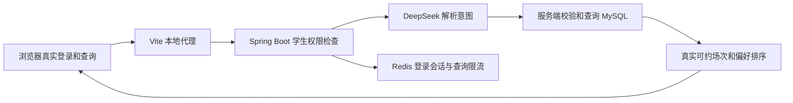

# 第 4 轮：本地完整链路联调

修改保留在 `feat/booking-assistant-local`，未提交或推送 GitHub。原有 WBA 容器、数据卷及 D 盘源码未更新。

本页保留第 4 轮完成时的只读联调记录；随后已增加用户核对后确认预约及系统评测，当前行为见[第 5 轮记录](ITERATION_05_CONFIRMED_BOOKING.md)。

## 结果

已实际验证以下链路，未模拟 API 或模型响应：



数据库使用本轮新建的独立 MySQL/Redis 容器，账号、导师、场次和占用记录均为模拟数据。候选的 ID、导师 ID、时间、评估类型、医院、科室和地点逐项与 MySQL 行核对。

## 如何体验

前置条件：Docker Desktop 已启动，安装 Java 25+、Maven、Node.js、Python 3.10+；前端目录已执行 `npm install`。启动脚本优先使用 `JAVA_HOME`，其余命令从 PATH 查找，并兼容本机已有安装位置。

根目录 `.env` 中设置第 3 轮文档列出的 `BOOKING_AI_*` 字段。脚本仅将这些字段传给后端；前端不接收模型密钥。根目录原有的数据库、邮件及 Google Calendar 凭据不用于演示环境。

在仓库根目录运行：

```powershell
python scripts/local_demo.py start
```

脚本构建后端，启动依赖容器，等待数据库初始化，启动 Java API 与 Vite。前端依赖需事先安装。已自行构建当前后端时，可加 `--skip-build`。

打开 [本地页面](http://127.0.0.1:5178)，以 `student@wba.test` / `WbaDemo!2026` 登录，进入 **Book Slots**。另外两个模拟导师是 `Dr Chen` 和 `Dr Lee`；医院为 `Prince of Wales Hospital`，科室为 `General Medicine`。

建议按顺序输入：

1. “帮我找下周二下午的 Mini-CEX，科室是 General Medicine，优先 Dr Chen，其他导师也可以”。应先展示 Dr Chen 的 15:00 场次，再展示 Dr Lee 的 14:00 场次。
2. “改成下周二和周四下午，必须是 Dr Chen，其他条件保持”。应保留下午与评估类型，仅展示 Dr Chen 的两个匹配场次。
3. 点击 **New search**，输入“找下周二下午的 Surgery”。应显示没有匹配场次。

AI 入口仍为只读查询。普通列表中的预约按钮沿用已有流程，不属于本轮验证的写入功能。

```powershell
python scripts/local_demo.py status
python scripts/local_demo.py stop
```

停止时检查进程的命令行归属，只停止本脚本记录的 Java/Vite 进程及 `wba-ai-demo` 服务；保留演示数据卷与生成的密码。脚本不提供自动删除数据卷或重置数据库的操作。

## 运行隔离与演示数据

| 项目 | 本地联调配置 |
| --- | --- |
| 页面 | `127.0.0.1:5178` |
| API | `127.0.0.1:8088` |
| MySQL | `127.0.0.1:13306` |
| Redis | `127.0.0.1:16379` |
| Compose 项目 | `wba-ai-demo`，独立于原编排 |
| 运行状态、日志、生成的数据库密码 | Git 忽略的 `.local/wba-demo/` |
| 模型配置 | Git 忽略的根目录 `.env` |

演示环境的 API 和通知流均经过 `/api` 代理，修复了原开发配置中的通知连接固定指向 8080、与本地 8088 API 不一致的问题。Vite 新增可选 `WBA_API_TARGET`，原默认代理地址继续为 8080。演示邮件连接仅指向本机，模拟用户关闭邮件通知，未配置 Google Calendar。

`scripts/demo/seed.sql` 仅挂载到演示 MySQL 的首次初始化目录，与基础表结构一起在新的演示数据卷中执行。它提供三个模拟用户、九个场次及一条 Pending 占用记录，分别覆盖上午、下午、其他星期、下一周、已停用、已占用及不同评估类型。演示口令为公开的本地测试口令，账户地址使用保留的 `.test` 域名。

首次初始化以 `Australia/Sydney` 的当天计算下周一，并将日期保存在 `demo_metadata`。数据卷重启后保留原日期；跨周使用时需根据 `demo_metadata` 中的日期搜索，或另行更新演示数据。脚本不会静默重建既有数据库。

## 验证结果

使用真实 Edge 浏览器完成登录，后续查询均通过真实接口与 DeepSeek。最终完整复测结果：

| 场景 | 预期与实际结果 | 页面请求耗时 |
| --- | --- | --- |
| 下周二下午 Mini-CEX，优先 Dr Chen | `READY`，优先导师排前，排除上午、已占用、已停用、其他星期、下周之外和不同类型场次 | 2502 ms |
| 补充星期二、四，必须 Dr Chen | `READY`，保留原类型和下午条件，仅返回该导师两个真实场次 | 1179 ms |
| 必须不存在的导师 | `CLARIFY`，不编造导师或候选 | 1101 ms |
| 澄清后改为 Dr Chen | `READY`，保留日期、类型与下午条件，返回一个真实场次 | 767 ms |
| 下周二下午 Surgery | `NO_RESULTS` | 930 ms |
| 要求直接预约并通知导师 | `UNSUPPORTED`，未执行写操作 | 1092 ms |

附加核对：

- 浏览器无页面异常、无失败 API 响应；通知流经本地代理成功连接。
- 查询前后逐行核对预约与场次的主要字段，内容一致，通知记录数一致；无预约或通知写请求。
- 检查 1440px 桌面及 390px 手机布局，日期保持业务时区，手机无横向溢出。
- 后端六模块打包成功；此前的 41 项后端测试本轮未改动业务代码，未重复运行。
- 前端 9 项测试、生产构建和本轮修改的 Vite 配置 ESLint 通过；构建保留既有大包提示。
- 演示 Compose 静态配置检查通过；停止及重新启动成功，演示数据库保留，原 WBA 容器仍保持停止状态。

首次真实浏览器运行的六个业务断言通过，但通知连接旧端口触发页面异常；修正演示配置后重新执行全部六个场景通过。因此本轮共发起 12 次真实模型调用，第 3 轮另有 3 次适配器冒烟调用。未统计 Token 与费用。这是小样本联调，不能据此推断整体理解准确率或生产稳定性。

## 主要文件

- [本地启动、状态与停止脚本](../../scripts/local_demo.py)
- [独立依赖容器编排](../../compose.demo.yml)
- [模拟账号和动态日期场次](../../scripts/demo/seed.sql)
- [可配置的 Vite 代理](../../unsw-comp9900-WBA-frontend/vite.config.js)

下一步可以围绕固定测试集评估中文表达、日期歧义和条件保持，再根据失败样本改进提示词与交互。AI 直接创建预约仍需先完善服务端提交校验、冲突检查和幂等处理。
