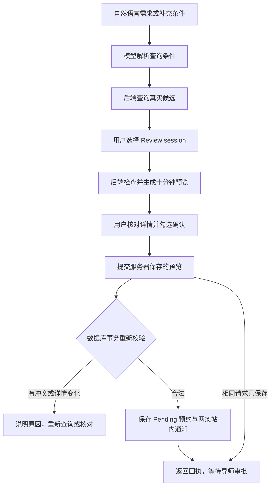

# 第 5 轮：确认式预约 Agent 与效果评测

修改仍在本地 `feat/booking-assistant-local`，未提交或推送 GitHub。数据库变更仅应用于独立的 `wba-ai-demo` 环境，原 D 盘项目及原部署未更新。

## 本轮交付

用户可以描述新预约需求，查看真实候选，点击 **Review session** 核对当前详情，勾选确认后提交预约请求。提交成功显示回执与 **awaiting supervisor approval**，最终批准仍由导师完成。



模型只解析意图，不接收执行工具、登录凭据或确认令牌，也不决定用户是否同意。新的“帮我预约”需求先搜索候选；修改、取消或批准已有预约仍通过原有业务页面处理。

## 本地体验

执行 `python scripts/local_demo.py start`，打开 [本地演示](http://127.0.0.1:5178)，以 `student@wba.test` / `WbaDemo!2026` 登录。

进入 **Book Slots**，输入“帮我预约下周二下午的 Mini-CEX，优先 Dr Chen，其他导师也可以”。选择候选的 **Review session**，核对导师、日期、时区、评估类型和地点，再勾选确认并提交。成功后在 **My Bookings** 查看 Pending 请求。

演示包含一条预置占用记录，另有上午、下午、停用及不同评估类型场次。日期仍以首次初始化的 `demo_metadata` 为准，见[第 4 轮说明](ITERATION_04_LOCAL_DEMO.md)。确认操作会实际写入本地演示数据库。

## 接口与确认边界

| 接口 | 输入与结果 |
| --- | --- |
| `POST /student/bookingAssistant/search` | 文本和先前用户需求；只查询候选，新增候选版本号 |
| `POST /student/bookingAssistant/prepare` | 候选的场次 ID、实际起止时间和版本；校验后返回当前详情、预览 ID、到期时间和业务时区，不创建预约 |
| `POST /student/bookingAssistant/confirm` | 仅接收 `draftId` 和 `confirmed: true`；使用后端保存的场次详情执行预约 |
| `POST /student/assessmentBooking/bookings` | 原普通预约入口，复用同一提交服务；前端携带稳定的 `requestKey` |

预览存入 Redis，有效期十分钟，键绑定当前学生 ID。其他学生不能使用同一预览；管理员及导师即使继承学生路径权限，也不能使用学生确认接口。确认时不接受客户端编辑的时段或导师字段。

后端保存显示详情的指纹并在提交时核对。因此，旧接口即使修改了地点等字段却未更新版本号，也会使预览失效。到期或详情变化时必须重新核对；已经成功保存的同一请求，即使预览到期，也可以按原请求获取回执。

## 预约校验与并发

普通预约和 AI 确认共同调用 `BookingSubmissionService`：

- 仅允许启用且未取消的学生向有效导师提交。
- 校验时段存在、未删除、启用、可预约、版本匹配，且开始时间在业务时钟的未来。
- 非重复场次的起止时间必须完全一致；重复场次必须属于实际 RRULE 序列、位于重复有效期内，并保持完整场次时长。
- 业务时区固定为 `Australia/Sydney`。夏令时跳变造成的不存在或含糊的本地时间会被拒绝。
- Pending 和 Confirmed 预约均占用时间；检查学生跨导师、导师跨场次以及同一场次的重叠，首尾相接的场次允许预约。
- 提交事务使用 `READ_COMMITTED`，按学生、导师、场次加数据库行锁；锁持续到事务提交。不同学生争抢同一导师的重叠场次时只有一个能成功。

搜索结果会随其他用户操作变化，预览及提交都会再次校验。跨场次冲突会在预览或提交时拒绝，并说明重新选择的原因。

## 幂等与失败反馈

数据库新增 `request_key`、`request_hash` 及唯一索引 `(creator, request_key)`。请求摘要包含场次、起止时间和版本。相同学生使用同一键与相同参数重试，返回已有预约 ID，不重复创建预约或站内通知；复用键却更换参数会被拒绝。

普通页面每次打开预约或切换实际场次生成新键，网络错误后的原地重试保留该键。AI 确认使用后端生成的预览 ID 派生请求键。已取消或逻辑删除的旧预约仍保留原请求身份；要重新预约必须开启一次新的核对操作。

成功回执包含 `bookingId`、当前状态、`replayed` 与 `notificationStatus`。数据库冲突、过期预览、无效场次及连接异常分别给出可操作反馈。网络中断时保留确认界面，提示重试同一请求或检查 My Bookings，避免以新请求掩盖未知结果。

本轮站内通知与预约在同一数据库事务内保存，学生和导师各一条。保存通知失败会回滚预约；事务提交后的实时推送失败不会把成功预约误报为失败，而是返回 `LIVE_DELAYED`。用户仍可查看消息中心。实时推送为尽力发送，回执不声称消息已被阅读、实时送达或邮件已发送。

## 数据库迁移

新的 `mysql-init.sql` 已包含幂等字段与索引。启动脚本只连接 `wba-ai-demo` 的 MySQL 服务，检查缺少的字段和索引并追加，不删除现有数据。SQL 说明保存在[演示增量迁移](../../scripts/demo/migrate_booking_submission.sql)。

原部署没有自动迁移，也未重建原有应用容器。未来更新原部署时，需要先处理该部署的数据库升级。

## 验证

后端 57 项测试通过，包含 14 项真实 H2/MyBatis/Spring 事务预约测试和新增确认接口权限、参数验证。覆盖并发相同请求、不同学生竞争、导师及学生时间重叠、幂等参数不一致、真实重复场次、过期及变更预览、夏令时、通知事务回滚与提交后推送失败。

真实 Edge 浏览器通过真实 DeepSeek、Spring、MySQL 和 Redis 验证：

1. “帮我预约”只展示候选，预览不创建预约，未勾选确认不能提交。
2. 实际转发一次确认后主动丢弃 HTTP 响应；界面提示重试，同一预览重试返回相同 Pending 预约 ID，数据库仅有一条预约和两条站内通知。
3. My Bookings 返回实际预约场次与 Pending 状态。
4. 另一学生无法使用该预览或获取其幂等回执。
5. 四个并行的同键请求仅保存一次；相同键更换参数被拒绝。
6. 跨模板的导师冲突、跨导师的学生冲突被拒绝。
7. 两名学生并发选择同一导师的两个重叠模板，真实 MySQL 仅允许一人成功。
8. 过期预览、未加版本号的地点变化、旧版本及伪造时间被拒绝。

浏览器无页面异常。核对 1440px 与 390px 的确认弹窗和回执，修复了弹窗通过 Portal 渲染时继承全局白字的问题。验证脚本只清理由其生成的准确预约 ID、关联测试通知和专用模拟数据，演示原有场次继续可用。

普通列表也单独通过真实页面提交验证，返回 Pending 回执并保存两条站内通知，未再由前端发送重复通知。

前端 9 项测试、生产构建、新组件/API/Axios 的 ESLint 通过。Book Slots 页面原先记录的 `set-state-in-effect` lint 问题与已有构建大包提示仍保留，不影响上述业务验证。

## 效果评测与复现

完整记录见 [AI 查询评测报告](../evaluation/BOOKING_AI.md)。首轮 40 条样本通过 37 条，针对失败改进提示词后 40 条通过；另加 10 条未用于本次提示词调整的表达，10 条通过。指标仅表示本次固定样本的结果。

```powershell
# 只查看评测计划，不调用模型
python scripts/evaluate_booking_ai.py

# 实际调用配置的模型，报告写入 Git 忽略的目录
python scripts/evaluate_booking_ai.py --live --output .local/wba-demo/evaluation.json
python scripts/evaluate_booking_ai.py --live --suite evals/booking_intents_holdout.json --output .local/wba-demo/holdout.json

# 浏览器验证默认不执行；--live 会实际调用模型并写入、清理独立演示数据
node scripts/demo/verify_booking_agent.cjs --live
```

浏览器脚本需要可用的 Playwright 模块与本机 Edge。可通过 `WBA_PLAYWRIGHT_MODULE` 指定已有模块路径，`WBA_DOCKER_EXE` 指定 Docker 命令路径；未指定时从 Node 模块路径与系统 PATH 查找。普通 Maven / 前端测试不调用真实模型。

## 主要文件

- [共享预约事务与校验](../../unsw-WBA-backend/unsw-WBA-service/src/main/java/edu/unsw/service/BookingSubmissionService.java)
- [服务器预览及确认](../../unsw-WBA-backend/unsw-WBA-service/src/main/java/edu/unsw/service/assistant/BookingConfirmationService.java)
- [AI 查询及确认页面](../../unsw-comp9900-WBA-frontend/src/components/BookingAssistant/index.jsx)
- [真实事务与并发测试](../../unsw-WBA-backend/unsw-WBA-service/src/test/java/edu/unsw/service/BookingSubmissionServiceTest.java)
- [浏览器验证脚本](../../scripts/demo/verify_booking_agent.cjs)
