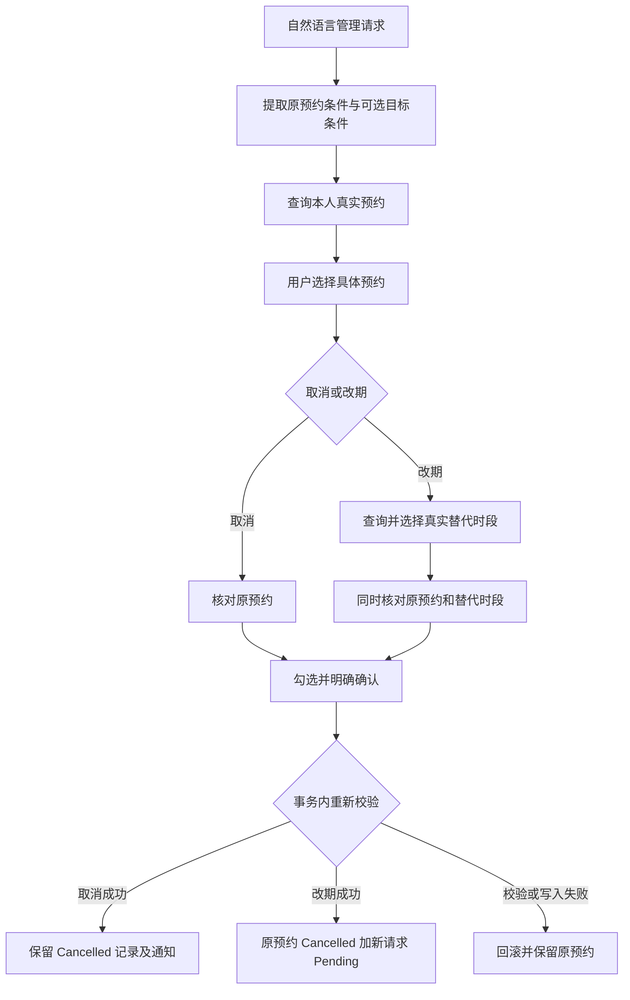

# 第 6 轮：预约管理

所有代码仍在本地分支 `feat/booking-assistant-local`，未提交或推送。仅更新独立的 `wba-ai-demo` 环境，保留原始项目、原部署及此前手动测试的预约。

## 用户流程

在 **Book Slots → AI booking assistant** 输入“查看我的预约”，或描述要取消、改期的预约。模型提取条件，服务端只查询当前登录学生的记录。最多展示 20 条匹配记录，更多结果需补充日期或导师；完整列表仍可在 **My Bookings** 查看。

- 取消：选择 **Review cancellation**，核对预约、日期、导师及地点，勾选后 **Confirm cancellation**。记录保留为 Cancelled。
- 改期：选择 **Reschedule**。若原指令带目标日期，自动查询替代时段；否则另行输入替代时段要求。选择 **Review reschedule**，同时核对原预约和替代时段，勾选后 **Confirm reschedule**。
- 改期成功：原预约变为 Cancelled，新增 Pending 请求，等待导师审批。替代时段不可用或通知持久化失败时，整笔事务回滚，原预约保持有效。
- 原有新预约流程继续使用真实候选、预览与明确确认；修改搜索条件仍是搜索，不会被当成改期。



## 规则与实现

仅 Pending、Confirmed 且尚未开始的预约可以管理。Confirmed 距开始不足 48 个实际小时不能取消或改期，恰好 48 小时允许。使用 Australia/Sydney 的服务端业务时钟，确认时重新检查，不依赖浏览器时区。

模型只返回白名单中的描述字段，不能提供预约 ID、候选 ID、确认令牌或执行工具。现有记录和候选 ID 均来自服务端查询。原预约条件与 `replacement` 条件分开；多个匹配结果必须由用户选择，每次处理一条，不支持批量取消或替导师审批。

预览在 Redis 保存 10 分钟并绑定学生，包含服务器复制的请求及原、新详情指纹。确认只提交 `draftId` 和 `confirmed:true`。预约状态、版本、地点、导师等变化会使旧预览失效。

管理事务先锁定学生，再按 ID 顺序锁定涉及的导师和时段，校验原预约版本、状态和指纹。改期在同一数据库事务内取消原预约、复用统一预约提交服务创建新请求、保存关联 ID 与站内通知；新请求与取消通知任意一步失败均回滚。替代时段的冲突检查只排除所选原预约，其余学生或导师重叠预约仍阻止提交。

取消使用状态 4，保留可见历史；释放原场次占用，重复模板的其他场次继续有效。新增 `management_key`、`replacement_booking_id` 与 `(creator, management_key)` 唯一索引。相同确认的持久回执支持并发重试、丢失响应后重试，以及 Redis 预览过期后查回已成功结果；未提交的过期预览不能执行。原 **My Bookings** 取消接口也接入同一服务，移除了前端重复发送通知的逻辑。

通知为事务内保存的站内消息，提交后发布实时提醒。实时提醒失败显示延迟状态，不把已成功的预约变更显示为失败；未接入外部邮件发送。

## 接口与数据库

沿用 `POST /student/bookingAssistant/search`，新增 BOOKING 查询结果 `BOOKINGS`，包含本人记录、建议动作和可选替代查询条件。

| 接口 | 用途 |
| --- | --- |
| `POST /student/bookingAssistant/management/replacements` | 校验原预约归属和可管理状态，查询并检查替代候选 |
| `POST /student/bookingAssistant/management/prepare` | 核对原预约及可选替代场次，生成预览 |
| `POST /student/bookingAssistant/management/confirm` | 明确确认预览，执行或回放结果 |

`scripts/local_demo.py start` 自动对演示库执行增量迁移，不删除数据。SQL 说明见 `scripts/demo/migrate_booking_management.sql`。已有其他部署若未来更新代码，需要先应用增量字段；本轮没有更新这些部署。`mysql-init.sql` 也包含新字段，适用于全新数据库初始化。

## 验证与体验

后端测试、前端测试、构建、真实模型评测与浏览器记录见 [本轮验证报告](../evaluation/BOOKING_MANAGEMENT.md)。可重复执行：

```powershell
# 常规测试不调用模型
cd unsw-WBA-backend
mvn -B -ntp -pl unsw-WBA-api -am test
cd ../unsw-comp9900-WBA-frontend
npm test
npm run build
cd ..

# 明确 opt-in：使用根目录 .env 的 DeepSeek 配置
python scripts/evaluate_booking_ai.py --live --suite evals/booking_management.json --output .local/wba-demo/management-evaluation.json

# 明确 opt-in：需演示环境运行、可用 Edge、Playwright 和 docker 命令
node scripts/demo/verify_booking_management.cjs --live
```

浏览器验证仅创建碰撞检查通过的专用账号、时段及预约，结束后按这些账号和精确 ID 清理，不修改演示学生已有预约。可通过 `WBA_PLAYWRIGHT_MODULE` 指定 Playwright 模块路径，通过 `WBA_DOCKER_EXE` 指定 Docker CLI。

手动体验：以 `student@wba.test` / `WbaDemo!2026` 登录 [本地演示](http://127.0.0.1:5178)，输入“查看我的预约”。也可以输入“查看我已取消的预约”或“查看我待导师确认的预约”。日期筛选请使用真实预约日期；原演示时段不会在每次启动时刷新，以便保留历史与手动测试数据。
